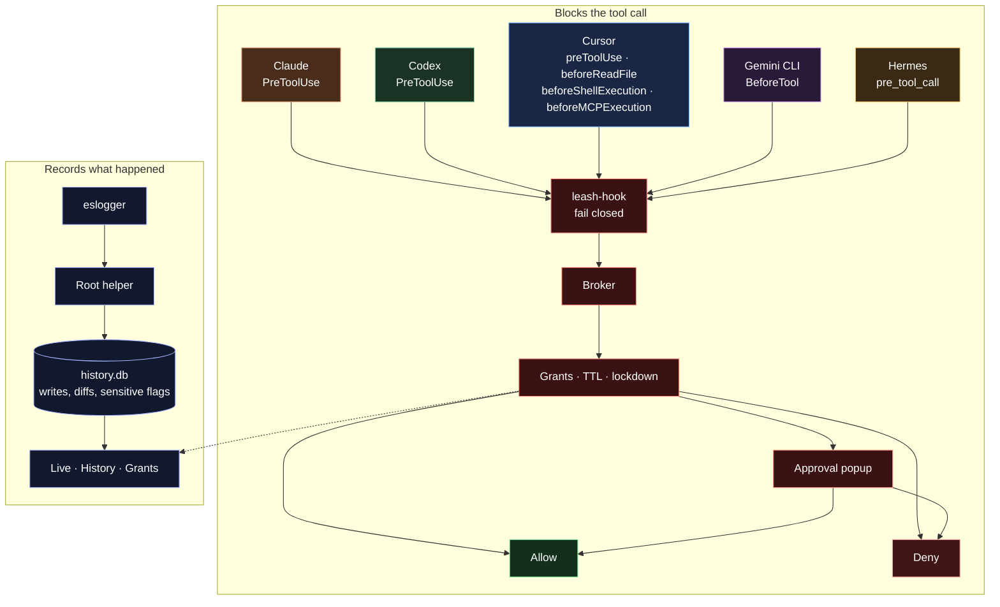

<p align="center">
  
</p>

<h1 align="center">Agentic Leash</h1>

<p align="center">See and control what AI coding agents can touch on your Mac.</p>

<p align="center">
  <a href="https://github.com/velusgautam/agentic-leash/releases/latest"></a>
  <a href="https://github.com/velusgautam/agentic-leash/releases"></a>
  <a href="https://github.com/velusgautam/agentic-leash/actions/workflows/ci.yml"></a>
  
  <a href="LICENSE"></a>
</p>

<p align="center">
  <a href="#download">Download</a> ·
  <a href="#features">Features</a> ·
  <a href="#how-it-hooks-in">How it works</a> ·
  <a href="#build-from-source">Build from source</a> ·
  <a href="https://github.com/velusgautam/agentic-leash/releases">Changelog</a>
</p>

Claude, Cursor, Codex, Gemini CLI and Hermes keep working. Agentic Leash watches the files they read and write, asks before they reach a folder you have not allowed, and flags sensitive paths like `~/.ssh` the moment they are touched.

## Download

Install from the terminal on macOS (Apple Silicon) or Linux (x64):

```bash
curl -fsSL https://github.com/velusgautam/agentic-leash/releases/latest/download/install.sh | bash
```

Or get the installer for your platform from the [latest release](https://github.com/velusgautam/agentic-leash/releases/latest).

| Platform | Installer | Status |
| --- | --- | --- |
| macOS, Apple Silicon | `.dmg`, signed and notarized | Supported |
| Windows x64 | `.exe` | Preview |
| Linux x64 | `.AppImage` | Preview |

On Windows and Linux, approvals and grants work, but the file-activity history does not. It relies on macOS `eslogger`.

Release notes for every version are on the [releases page](https://github.com/velusgautam/agentic-leash/releases).

## Supported agents

| Agent | Hook events |
| --- | --- |
| Claude (desktop app and `claude` CLI) | `PreToolUse` |
| Codex | `PreToolUse` |
| Cursor | `preToolUse`, `beforeReadFile`, `beforeShellExecution`, `beforeMCPExecution` |
| Gemini CLI | `BeforeTool` |
| Hermes | `pre_tool_call` |

## Features

### Grants on a timer


A grant can last one call, a session, a day, or forever. The Access page lists every live grant with its time left. Filter the list by agent and sort it by when it was approved or when it expires.

### Revoke, then lock down


Revoke a single grant, or revoke every grant at once. Revoke all turns lockdown on, so the next tool call is blocked until you end it.

### Every write keeps its diff


History stores the before and after of each write. Open it later and the diff is still there, next to the grant that allowed the path.

### Sensitive paths turn red


Reads of `~/.ssh`, `~/.aws` and other secret paths are marked in red on Live and in History, with a count on the Sensitive filter.

### Ask before a new folder


A tool call outside an existing grant opens this popup. Allow it once, for this session or for today, widen it to the whole folder, or deny it. Never blocks it for good. The same choices are on the Access page while a request is waiting.

### Appearance


System, light, or dark. Contrast, transparency, and density apply across the app.

## How it hooks in



Setup installs the hook into each agent that is turned on. The hook asks the broker before the tool runs. A matching grant that has not expired is allowed. Lockdown denies. Anything else waits on the approval popup.

Separately, a root helper tails `eslogger` and writes file activity into `history.db`, including the before and after of writes and a sensitive flag. Live and History read that database. The grant shown beside a write is the one whose folder covers the path.

## First run

The first open stays on setup until the history helper is running and Full Disk Access is granted. The helper is a root LaunchDaemon, so macOS asks for an administrator password once. Turning an agent off in Settings hides it and removes its hooks.

## Build from source

Needs macOS on Apple Silicon, Node 24 and pnpm 12.

```bash
pnpm install
pnpm dev
```

| Command | What it does |
| --- | --- |
| `pnpm test` | Runs the unit tests |
| `pnpm test:e2e` | Builds the app and runs the Playwright tests against the window |
| `pnpm dist` | Builds the signed macOS installer into `dist/` |
| `pnpm dist:win`, `pnpm dist:linux` | Build the Windows and Linux installers |

In a dev build the helper step in setup reads "Available in the installed app".

### Screenshots

```bash
pnpm build
SCREENSHOTS=1 pnpm exec playwright test tests/e2e/marketing.e2e.ts -g walkthrough
pnpm exec node docs/media/launch/record-stills.mjs
```

The first command builds the app. The second captures the app frames into `docs/media/walkthrough`. The third turns those frames into the banner and the feature images.

## License

[MIT](LICENSE). Code copied from other projects keeps its own license, listed in [THIRD_PARTY_LICENSES.md](THIRD_PARTY_LICENSES.md).
