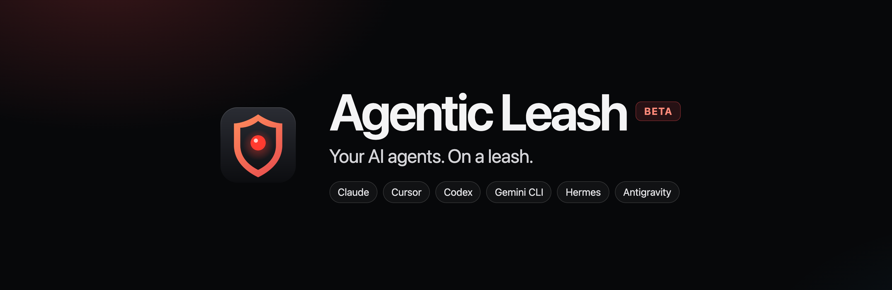
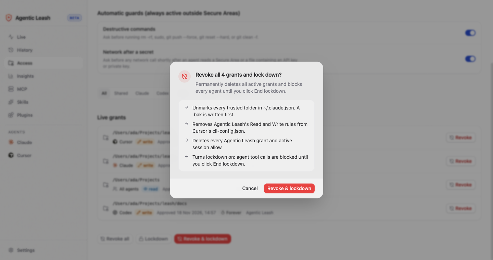
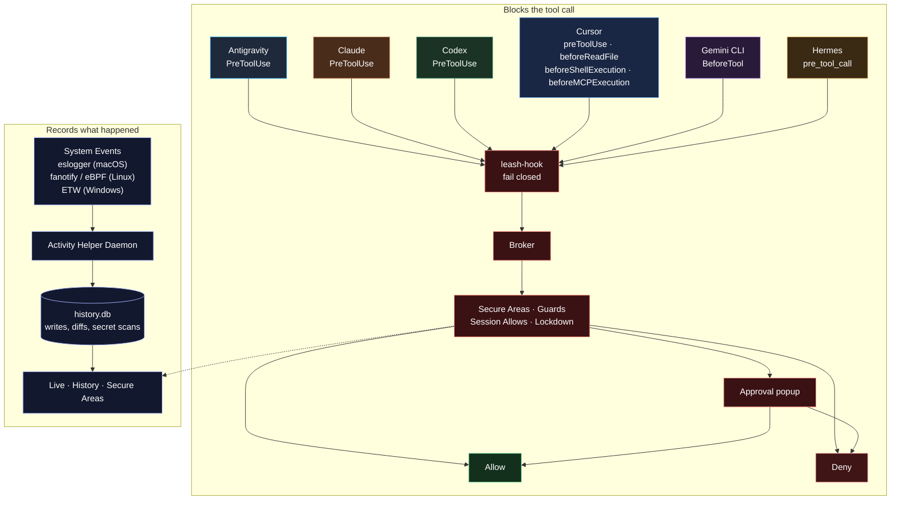

<p align="center">
  
</p>

<h1 align="center">Agentic Leash</h1>

<p align="center">See and control what AI coding agents can touch across macOS, Linux, and Windows.</p>

<p align="center">
  <a href="https://github.com/velusgautam/agentic-leash/releases/latest"></a>
  <a href="https://github.com/velusgautam/agentic-leash/releases"></a>
  <a href="https://github.com/velusgautam/agentic-leash/actions/workflows/ci.yml"></a>
  
  <a href="LICENSE"></a>
</p>

<p align="center">
  <a href="#about">About</a> ·
  <a href="#download">Download</a> ·
  <a href="#supported-agents">Supported agents</a> ·
  <a href="#features">Features</a> ·
  <a href="#how-it-hooks-in">How it works</a> ·
  <a href="#build-from-source">Build from source</a> ·
  <a href="https://github.com/velusgautam/agentic-leash/releases">Changelog</a>
</p>

Claude, Cursor, Codex, Gemini CLI, Hermes, and Antigravity keep working freely across your codebase. Agentic Leash gates **Secure Areas** (keys, credentials, personal folders, startup files) with separate Read and Write rules, runs automatic guards for destructive commands and post-secret network calls, and maintains a low-noise audit trail.

## About

AI coding agents are powerful, but by default they inherit your user account's full filesystem permissions. A rogue prompt, runaway loop, or indirect prompt injection can read your SSH keys (`~/.ssh`), cloud credentials (`~/.aws`), and local secrets (`.env`), or run destructive commands.

In the wild, unconstrained agents have caused catastrophic data loss—such as [Claude CLI wiping an entire user home directory](https://www.reddit.com/r/ClaudeAI/comments/1pgxckk/claude_cli_deleted_my_entire_home_directory_wiped/) or [Google Antigravity deleting drive contents](https://www.reddit.com/r/google_antigravity/comments/1p82or6/google_antigravity_just_deleted_the_contents_of/) when path boundaries hallucinated.

**Agentic Leash** provides a zero-friction safety leash and observability guardrail for AI coding assistants. Everything outside your configured **Secure Areas** is allowed and logged automatically, while sensitive paths, destructive commands, and post-secret network calls stop for explicit approval.

### Core Principles

- **Allow-by-default outside Secure Areas**: Normal coding flows without constant popups or timers. Only paths matching a **Secure Area** (or an active guard) pause for confirmation.
- **Secure Areas with Read/Write rules (`Allow` / `Ask` / `Block`)**: Pre-configured protection for Secrets (`~/.ssh`, `~/.aws`, `~/.gnupg`, etc.), Project secrets (`.env*`, `*.pem`, `*.key`), Notes & personal data, Personal folders (`Desktop`, `Downloads`, `Documents`), Always blocked locations (browser profiles, Keychains, Messages, Mail), and Startup files (`.zshrc`, `LaunchAgents`, `.git/hooks`, agent configs).
- **Automatic Safety Guards**:
  - **Destructive commands**: Prompts before `rm -rf`, `sudo`, `git push --force`, `git reset --hard`, or `git clean -f` outside safe rules.
  - **Network after a secret**: Prompts on outbound network calls made within 60 seconds of reading a Secure Area or a file containing an inline secret.
- **Content secret scanning**: Reads of files containing key patterns (`sk-`, `ghp_`, `github_pat_`, `AKIA`, `xoxb-`, PEM private keys) are flagged in History and arm the post-secret egress guard without interrupting normal reads.
- **Session-bounded approvals (`Once` / `This session` / `Today`)**: Rare prompts show full context (agent, path, matched Secure Area, command) and auto-deny after 120 seconds if unanswered.
- **High-signal History & Live (~98.5% noise reduction)**: Filters out build artifacts, system paths, SQLite WAL files, and non-sensitive raw reads, merges duplicate hook/filesystem writes with full diffs, collapses recursive reads (50+ files) into summaries, and lets you protect any path in one click with **🔒 Protect**.
- **Per-agent Skills, Plugins & MCP management**: Discover plugins across Claude Code, Cursor, Codex, Gemini, Antigravity, and Hermes; filter Skills, Plugins, and MCP servers by agent; and track per-agent skill usage counts.
- **Emergency lockdown**: Hit `⌃⌥⌘L` (or `Ctrl+Alt+Shift+L` on Linux/Windows) or click *Revoke All* to activate lockdown and fail-closed deny subsequent tool calls.
- **100% local & zero telemetry**: All rules, sockets, logs, and databases live on your machine. No cloud relays, no tracking, no account needed.

## Download

Install from the terminal on macOS (Apple Silicon) or Linux (x64):

```bash
curl -fsSL https://github.com/velusgautam/agentic-leash/releases/latest/download/install.sh | bash
```

Or get the installer for your platform from the [latest release](https://github.com/velusgautam/agentic-leash/releases/latest).

| Platform | Installer | Status |
| --- | --- | --- |
| macOS, Apple Silicon | `.dmg`, signed and notarized | Supported |
| Linux x64 | `.AppImage`, `.deb` | Supported |
| Windows x64 | `.exe` (NSIS with automatic service setup) | Supported |

Across macOS, Linux, and Windows, pre-execution tool gating hooks, time-bounded grants, approval popups, and the activity helper daemon for live and historical auditing are supported.

Release notes for every version are on the [releases page](https://github.com/velusgautam/agentic-leash/releases).

## Supported agents

| Agent | Hook events |
| --- | --- |
| Antigravity (IDE and `agy` CLI) | `PreToolUse` |
| Claude (desktop app and `claude` CLI) | `PreToolUse` |
| Codex | `PreToolUse` |
| Cursor | `preToolUse`, `beforeReadFile`, `beforeShellExecution`, `beforeMCPExecution` |
| Gemini CLI | `BeforeTool` |
| Hermes | `pre_tool_call` |

## Features

### Secure Areas & Session Allows


Configure Secure Areas during setup, in Settings, or directly from any Live or History row using **🔒 Protect**. Each Secure Area defines independent **Read** and **Write** rules (`Allow`, `Ask`, or `Block`). Temporary approvals (`Once`, `This session`, or `Today`) appear on the Access page and can be revoked at any time.

### Revoke, then lock down



Revoke an individual session allow, or click *Revoke All* to turn Lockdown on so every subsequent tool call is blocked until you unlock.

### Every write keeps its diff & recursive reads collapse


History merges duplicate hook and filesystem writes into one row with before/after diffs, collapses noisy recursive scans (50+ files) into single summary rows, and lets you export audit logs directly from the UI.

### Sensitive paths & inline secrets turn red


Secure Area hits, destructive commands, post-secret network calls, and files containing detected API keys or private keys are flagged across Live and History.

### Rare, high-context prompts


When an agent hits an `Ask` Secure Area or a safety guard, a popup appears with full context (agent, path, matched Secure Area, and command) and lets you choose **Allow once**, **Allow this session**, **Allow today**, or **Deny** (with a 120 s timeout).

### Skills, Plugins & MCP per agent

Filter **Skills**, **Plugins**, and **MCP Servers** by agent (`All agents`, `Claude Code`, `Antigravity`, `Cursor`, `Codex`, `Gemini`, `Hermes`), inspect agent-scoped skill usage counts, discover plugins across every agent's plugin directory, and manage Hermes skills and MCP configurations alongside other agents.

### Appearance


System, light, or dark. Contrast, transparency, and density apply across the app.

## How it hooks in



Setup installs the hook into each enabled agent and walks through the pre-selected **Secure Areas** step. The hook asks the broker before the tool runs. Calls outside Secure Areas are allowed and logged; Secure Areas with `Ask`, destructive commands, and network calls after a secret pause on the approval popup; `Block` Secure Areas and Lockdown deny immediately.

Separately, a system activity helper tails system event streams (`eslogger` on macOS, fanotify/eBPF on Linux, and ETW on Windows), deduplicates hook/filesystem writes, collapses recursive scans, and writes structured activity into `history.db` (90-day retention for sensitive rows, 14-day retention for ordinary activity, 500 MB cap). Live and History read that database.

## First run

The first open stays on setup until the activity helper is running (and on macOS, Full Disk Access is granted). The helper runs as a system service (LaunchDaemon on macOS, systemd unit on Linux, or Windows Service), so your OS will ask for administrator/elevation confirmation once during setup. Turning an agent off in Settings hides it and removes its hooks.

## Build from source

Requires Node 24 and pnpm 12 (tested on macOS, Linux, and Windows).

```bash
pnpm install
pnpm dev
```

| Command | What it does |
| --- | --- |
| `pnpm test` | Runs the unit tests |
| `pnpm test:e2e` | Builds the app and runs the Playwright tests against the window |
| `pnpm dist` | Builds the signed macOS installer into `dist/` |
| `pnpm dist:win`, `pnpm dist:linux` | Build the Windows and Linux installers |

In a dev build the helper step in setup reads "Available in the installed app".

### Screenshots

```bash
pnpm build
SCREENSHOTS=1 pnpm exec playwright test tests/e2e/marketing.e2e.ts -g walkthrough
pnpm exec node docs/media/launch/record-stills.mjs
```

The first command builds the app. The second captures the app frames into `docs/media/walkthrough`. The third turns those frames into the banner and the feature images.

## License

[MIT](LICENSE). Code copied from other projects keeps its own license, listed in [THIRD_PARTY_LICENSES.md](THIRD_PARTY_LICENSES.md).
