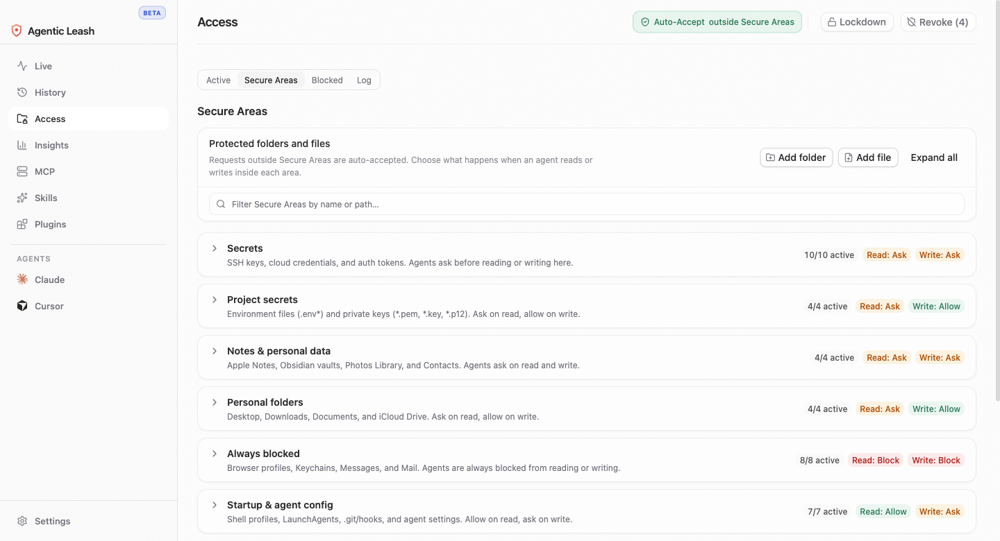
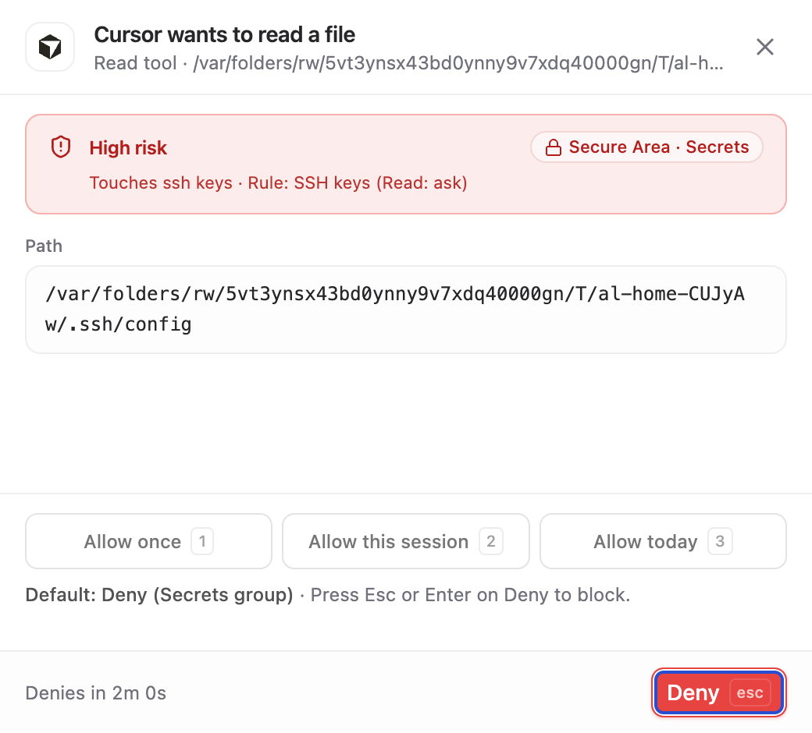
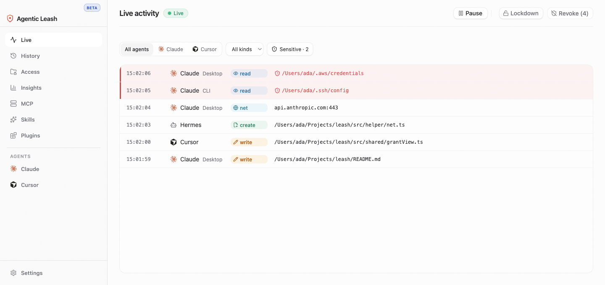
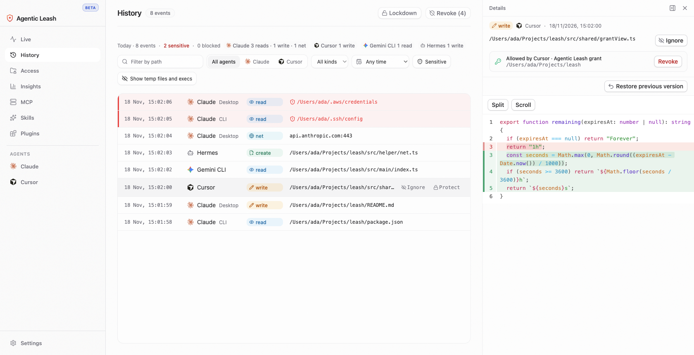
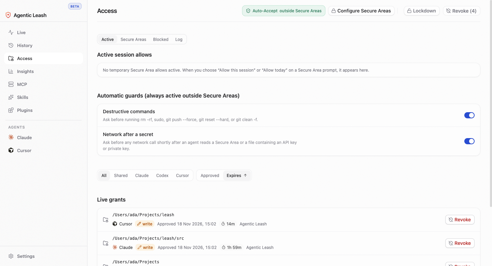
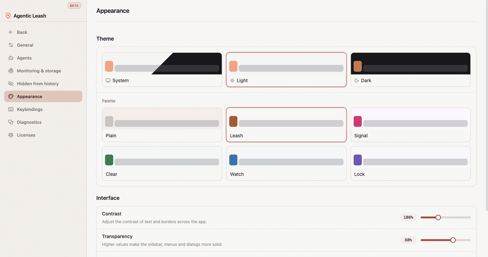
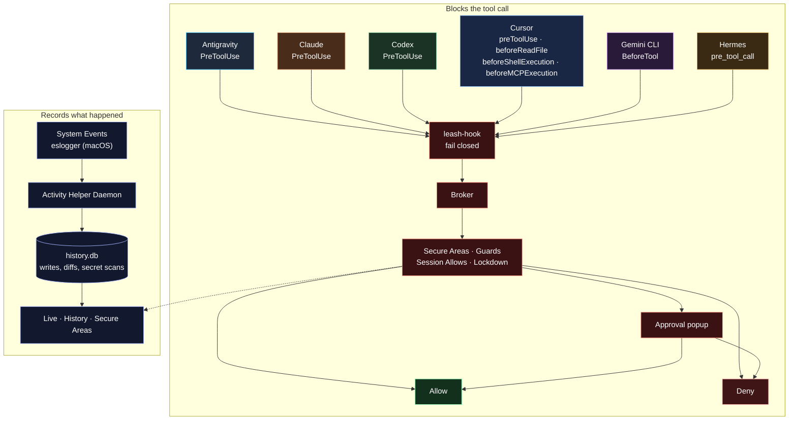

<p align="center">
  
</p>

<h1 align="center">Agentic Leash</h1>

<p align="center">
  <strong>Zero-friction security &amp; live observability for AI coding agents on macOS.</strong><br/>
  Let Claude, Cursor, Codex, Gemini CLI, Hermes, and Antigravity code at full speed — while your keys, secrets, and personal files stay protected.
</p>

<p align="center">
  <a href="https://github.com/velusgautam/agentic-leash/releases/latest"></a>
  
  <a href="https://github.com/velusgautam/agentic-leash/releases"></a>
  <a href="https://github.com/velusgautam/agentic-leash/actions/workflows/ci.yml"></a>
  
  <a href="LICENSE"></a>
</p>

<p align="center">
  <a href="#why-agentic-leash">Why Agentic Leash?</a> ·
  <a href="#download">Download</a> ·
  <a href="#supported-agents">Supported agents</a> ·
  <a href="#features">Features</a> ·
  <a href="#how-it-hooks-in">How it works</a> ·
  <a href="#build-from-source">Build from source</a>
</p>

---

## Why Agentic Leash?

AI coding agents are fast, autonomous, and run with **your full user permissions**. One bad prompt, runaway loop, or indirect prompt injection can read your SSH keys (`~/.ssh`), cloud credentials (`~/.aws`), and `.env` secrets, or run destructive shell commands.

In the wild, unconstrained agents have caused catastrophic data loss — from [Claude CLI wiping a home directory](https://www.reddit.com/r/ClaudeAI/comments/1pgxckk/claude_cli_deleted_my_entire_home_directory_wiped/) to [Antigravity deleting drive contents](https://www.reddit.com/r/google_antigravity/comments/1p82or6/google_antigravity_just_deleted_the_contents_of/).

**Agentic Leash flips the model from noisy popups to smart boundaries:**
- **Work freely everywhere else** — Everything outside your **Secure Areas** is auto-accepted and audited quietly.
- **Gate what actually matters** — Independent **Read** and **Write** rules (`Allow`, `Ask`, `Block`) for Secrets, `.env` files, Personal folders, Notes, and Startup configs.
- **Stop dangerous surprises** — Automatic guards catch `rm -rf`, `git push --force`, `sudo`, and outbound network calls right after reading a secret.
- **100% local & zero telemetry** — Every rule, Unix socket, SQLite database, and audit diff stays on your Mac.

---

## Download

Install in one line on macOS (Apple Silicon):

```bash
curl -fsSL https://github.com/velusgautam/agentic-leash/releases/latest/download/install.sh | bash
```

Or grab the signed & notarized `.dmg` from the [latest release](https://github.com/velusgautam/agentic-leash/releases/latest).

| Platform | Installer | Status |
| --- | --- | --- |
| macOS (Apple Silicon) | `.dmg`, signed & notarized | Supported (Beta) |

---

## Supported agents

| Agent | Hook events |
| --- | --- |
| **Antigravity** (IDE & `agy` CLI) | `PreToolUse` |
| **Claude** (Desktop app & `claude` CLI) | `PreToolUse` |
| **Codex** | `PreToolUse` |
| **Cursor** | `preToolUse`, `beforeReadFile`, `beforeShellExecution`, `beforeMCPExecution` |
| **Gemini CLI** | `BeforeTool` |
| **Hermes** | `pre_tool_call` |

---

## Features

### 🔒 Secure Areas with Read & Write Rules



Protect your Mac in seconds with pre-configured **Secure Areas**:
- **Secrets** (`~/.ssh`, `~/.aws`, `~/.gnupg`, tokens)
- **Project secrets** (`.env*`, `*.pem`, `*.key`, `*.p12`)
- **Notes & personal data** (Apple Notes, Obsidian vaults, Photos, Contacts)
- **Personal folders** (`Desktop`, `Downloads`, `Documents`, `iCloud Drive`)
- **Always blocked** (Browser profiles, Keychains, Messages, Mail)
- **Startup & agent config** (`.zshrc`, `LaunchAgents`, `.git/hooks`)

Add any custom folder or file, or click **🔒 Protect** straight from any Live or History row.

---

### ⚡ Rare, High-Context Approval Prompts



Normal coding never gets interrupted. Only when an agent touches an `Ask` Secure Area or triggers a safety guard does a crisp, keyboard-first prompt appear:
- Shows the **agent**, **risk level**, **matched Secure Area & rule**, **path**, and **command**
- Choose **Allow once** (`1`), **Allow this session** (`2`), **Allow today** (`3`), or **Deny** (`Esc`, auto-denies in 120s)
- Sticky action bar keeps controls visible even on long commands or multi-path requests

---

### 🚨 Live Activity & Inline Secret Detection



Watch every file read, write, exec, and network call across all connected agents in real time. Secure Area hits and inline secrets (`sk-`, `ghp_`, `github_pat_`, `AKIA`, `xoxb-`, PEM keys) light up in red and automatically arm the **Network after a secret** egress guard.

---

### 🧬 Full Write Diffs & ~98.5% Noise Reduction



History filters out build artifacts, system noise, and non-sensitive raw reads, collapses 50+ file recursive scans into clean summaries, merges duplicate hook/filesystem writes with **side-by-side before/after diffs**, and lets you restore previous file versions in one click.

---

### 🛡️ Session Allows, Automatic Guards & Live Grants



Inspect every active **Session Allow** and **Live Grant** sorted by expiry, toggle **Destructive commands** and **Network after a secret** guards, or revoke individual permissions on the spot.

---

### 🛑 Pause with Lockdown or Permanently Revoke


Full control when you need to hit the brakes:
- **Lockdown** — Temporarily blocks all agent calls and pauses active grants; click **End lockdown** to restore them.
- **Revoke all** — Permanently clears all active grants and session allows without locking down.
- **Revoke & lockdown** — Permanently clears all grants *and* blocks every agent until you end lockdown (`⌃⌥⌘L`).

---

### 🧩 Skills, Plugins & MCP per Agent

Browse and filter **Skills**, **Plugins**, and **MCP Servers** across **Claude Code**, **Antigravity**, **Cursor**, **Codex**, **Gemini CLI**, and **Hermes**, with per-agent skill usage counts.

---

### 🎨 Light, Dark & Custom Palettes



System, Light, or Dark mode with 6 built-in palettes (**Plain**, **Leash**, **Signal**, **Clear**, **Watch**, **Lock**) plus adjustable contrast, transparency, and density.

---

## How it hooks in



Setup installs the hook into each enabled agent and walks you through **Secure Areas**. Calls outside Secure Areas are allowed and logged; `Ask` Secure Areas, destructive commands, and network calls after a secret pause on the approval popup; `Block` Secure Areas and Lockdown deny immediately.

Separately, the system activity helper tails macOS `eslogger` streams, deduplicates hook/filesystem writes, collapses recursive scans, and writes structured activity into `history.db` (90-day retention for sensitive rows, 14-day retention for ordinary activity, 500 MB cap).

---

## Build from source

Requires Node 24 and pnpm 12 on macOS.

```bash
pnpm install
pnpm dev
```

| Command | What it does |
| --- | --- |
| `pnpm test` | Runs the unit tests |
| `pnpm test:e2e` | Builds the app and runs the Playwright tests |
| `pnpm dist` | Builds the signed macOS installer into `dist/` |

### Capturing marketing screenshots

```bash
pnpm build
SCREENSHOTS=1 pnpm exec playwright test tests/e2e/marketing.e2e.ts -g "marketing screenshots"
```

## License

[MIT](LICENSE). Code copied from other projects keeps its own license, listed in [THIRD_PARTY_LICENSES.md](THIRD_PARTY_LICENSES.md).
