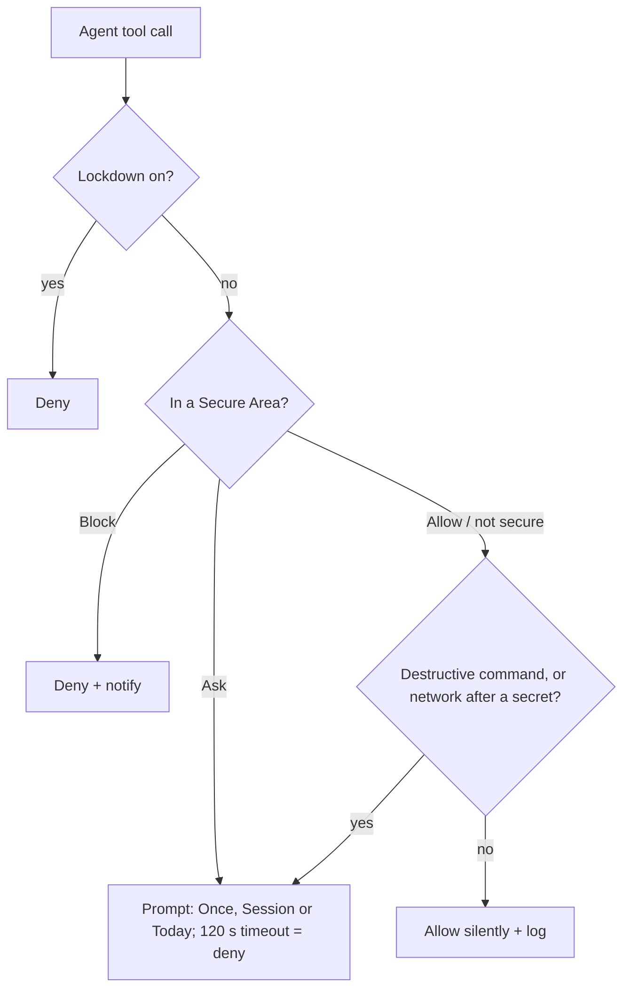

# Agentic Leash: "Secure Areas" proposal

Based on your real data ([leash_real_data_findings.md](file:///Users/velugautam/.gemini/antigravity-cli/brain/29ec5100-3cae-4c14-a509-a4d4e8f5d904/leash_real_data_findings.md)) and the decisions you settled in the Q&A (Q1–Q25).

## Summary of my opinion
- **Prompting on everything gave you friction and no security.** You saw 9 prompts, approved all 9 in 2–10 s each, and denied nothing. 8 of the 9 were harmless.
- **Ask only where it matters, and log everything else quietly.** Few prompts means each one gets read. That's how the prompts become protection again.
- **Two automatic guards stay on even in God Mode,** because they cover risks folder rules can't: destructive commands, and network calls shortly after a secret was read.
- **The history should be an audit trail, not a raw feed of every file touched.** About 98.5% of today's rows add no information.

---

## 0. Fix first (first piece of work in v0.9)
- **Decision log stopped writing on 2026-11-06.** Hook events kept arriving afterwards, but nothing was written to `decisions`. Fix the root cause, stop swallowing the error ([handle.ts:175-192](file:///Users/velugautam/Projects/Agentic-Leash/src/hook/handle.ts#L175-L192)), and show a health warning when writes fail.
- **The "network after a secret" check depends on that table** ([db.ts:308](file:///Users/velugautam/Projects/Agentic-Leash/src/shared/db.ts#L308)). Give it a reliable source and add a test that fails if the check stops working.
- **Add an "Export audit data" button,** so users can hand their data to someone else or a tool without copying files around with `sudo`.

## 1. Security model
- **God Mode is always on.** Anything outside a Secure Area is allowed and logged. The God Mode timer and the separate Auto Accept Mode go away.
- **Each Secure Area has separate rules for read and write:** Allow, Ask, or Block.
- **The two guards stay on in God Mode,** each with its own switch and a warning when you turn it off:
  - **Destructive commands:** `rm -rf` outside the repo, `sudo`, `git push --force`, `git reset --hard`, `git clean -f`.
  - **Network after a secret:** any network call within 60 s of reading a Secure Area or a file that contains a key.
- **Keys inside code files are detected by scanning the content** (`sk-`, `ghp_`, `AKIA`, `xoxb-`, PEM blocks…). A match never prompts. It marks the session as "has seen a secret", which arms the network guard, and adds a 🔑 badge in History.
- **Approval lengths: Once, This session, or Today.** There's no "Always": a permanent yes is the same as removing the entry from Secure Areas, so you'd do that in Settings instead.
- **Writes are allowed everywhere** except the Secrets group (`.ssh` and similar) and startup files, which ask on write.
- **Unanswered prompts are denied after 120 s,** followed by a notification ("Claude wanted ~/.ssh/config; denied").
- **The model touching the keychain stays a Secure Area event.** When the agent CLI fetches its own login token (`security` launched by the agent program itself), it's logged as one daily line with no red badge.
- **Lockdown and Leash's protection of its own files stay unchanged.**

## 2. First-launch setup (UX)
- **A new "Secure Areas" step** after the existing hooks, history helper and Full Disk Access steps. Every entry is **pre-selected**, and you can switch any one off.

| Group | Entries | Read | Write |
|---|---|---|---|
| Secrets | `~/.ssh`, `~/.gnupg`, `~/.aws`, `~/.config/gcloud`, `~/.kube`, `~/.azure`, `~/.config/gh`, `.netrc`, `.npmrc`, `.git-credentials` | Ask | Ask |
| Project secrets | `.env*` (not `.env.example`), `*.pem`, `*.key`, `*.p12` | Ask | Allow |
| Notes and personal data | Apple Notes, Obsidian vaults, Photos, Contacts | Ask | Ask |
| Personal folders | Desktop, Downloads, Documents, iCloud Drive | Ask | Allow |
| Always blocked | Browser profiles, Keychains, Messages, Mail | Block | Block |
| Startup files | `.zshrc`, LaunchAgents, `.git/hooks`, agent config files | Allow | Ask |

- **"+ Add folder or file"** for your own entries, e.g. a folder where you keep API keys.
- **Three ways to add a Secure Area:**
  1. **First-launch setup:** the pre-selected list above.
  2. **From Live or History:** a **"🔒 Protect"** button on every row, next to the existing Ignore button. It opens a small picker where you choose the scope (this file, its folder, or a parent folder) and the read and write rules.
  3. **Settings → Secure Areas:** add, edit, switch off, or remove entries by hand. Changes apply immediately.
- **Show what each choice means in plain words,** e.g. "Ask on read: Claude must ask before opening files here."

## 3. Prompt UX
- **Prompts become rare,** so each one carries full context: agent, exact path, which Secure Area matched, the command, and why it was stopped.
- **Buttons:** Allow once · Allow this session · Allow today · Deny. The default focus is Deny for the Secrets group.
- **Batch prompts stay,** but they never offer "Allow all" across the Secrets group.
- **Removed from the prompt:** the scope chips (file, folder, repo), "Always in repo", "Always", "Never", the 15 min / 1 h / 8 h presets, and the "switch to Auto Accept" button.

## 4. History and Live: logging less, more usefully
Measured on your 41,661 rows:

| Step | Rows kept | Removed |
|---|---|---|
| Built-in hidden paths: build outputs, system paths, `-wal`/`-shm`/`-journal`, keychain `.sb-*` temp files | 3,788 | 90.9% |
| Also drop raw file-system reads outside Secure Areas | 639 | 98.5% |
| Also label the agents' own token refreshes | about 300 | ~99.3% |

- **Duplicate writes are merged.** The hook row and the file-system row become one: matched by agent, path and a time window of about 2 s, keeping both the hook's details and the diff.
- **One recursive command becomes one row.** Any process reading more than about 50 files becomes a summary ("`grep -rn …` read 4,411 files under `macos/.build`"). Files in Secure Areas are still logged one by one.
- **Writes outside Secure Areas are grouped** into one row per session per folder ("wrote 47 files in `src/`, 14:02–14:20"), with the diffs one click away.
- **"Sensitive" means only:** Secure Area hits, detected secrets, destructive commands, and network calls after a secret.
- **Live shows only:** tool calls, writes and deletes, network calls, Secure Area and secret activity, and recursive-command summaries. Everything else is in History, behind the existing "include noise" switch.
- **A "Verbose capture" switch** brings back full logging temporarily, for debugging.
- **Retention:** security rows 90 days, everything else 14 days, with a 500 MB cap (down from 10 GB).
- **New built-in hidden paths appear under Settings → Hidden from history,** where each can be switched off.

## 5. Skills, plugins and MCP per agent
- **An agent selector** at the top of the Skills, Plugins and MCP pages (view filter), showing that agent's usage counts.
- **The existing per-agent pills stay** as the control for which agents may use each item.
- **Plugin discovery covers every agent,** including `~/.claude/plugins`, Cursor and Codex. **Hermes is added** to skill and MCP discovery.
- **Usage tracking per model is out of scope** for now; it records the agent only.

## 6. Usability guarantees
- **Expected prompt rate:** on your data, essentially zero during normal coding. Prompts would only have appeared for real Secure Area access or `rm -rf`.
- **No timers to renew** and no God Mode toggle to keep switching on.
- **Every silent allow is still visible** in History, so trusting the system doesn't mean losing the audit trail.

## 7. Rollout: everything ships in v0.9 (one release)
Built as separate pieces of work, each reviewed before it is merged into the v0.9 branch:
1. **Decision log and guard fix:** fix the decision log and the network-after-secret check, add the health warning and the export button. This comes first because the guards depend on it.
2. **Secure Areas engine:** the new decision logic, the `secure_areas` and `session_allows` tables, removal of the old flow, the destructive-command and network guards, and content scanning for keys.
3. **Secure Areas UI:** the setup step, the new prompt (Once / Session / Today), Settings → Secure Areas, and the 🔒 Protect button in Live and History.
4. **History reduction:** built-in hidden paths, merged writes, recursive-command summaries, grouped writes, labelled token refreshes, the new Live filter, retention, and Verbose capture.
5. **Skills, plugins and MCP:** the agent selector, plugin discovery across all agents, and Hermes support.
6. **Release check:** unit and end-to-end tests for the new flow, README and docs updates, and a clean-install plus upgrade test on macOS.

> [!IMPORTANT]
> **Migration: a clean break (confirmed).** v0.9 removes the old approval flow entirely and replaces it.
> - **Removed:** the God Mode and Auto Accept Mode toggles and timers; folder and repo grants; "Always" rules; Never blocks; the 15m/1h/8h/repo presets; and the old approval logic for personal folders and secrets. In the database, the `grants`, `rules`, `blocks` and `approvals` tables are dropped, along with the `god_mode_*` and `auto_accept_*` settings.
> - **Replaced by:** a `secure_areas` table (path or pattern, read rule, write rule, group, on/off, built-in flag) and a `session_allows` table (path, agent, session, expires at: once, session or end of day).
> - **Kept:** Lockdown, Leash's protection of its own files, the safe-command list (used only to skip the destructive-command check), Hidden from history, and the existing history data.
> - **On upgrade:** every user sees the Secure Areas setup step with the pre-selected list, exactly as a new install does.
